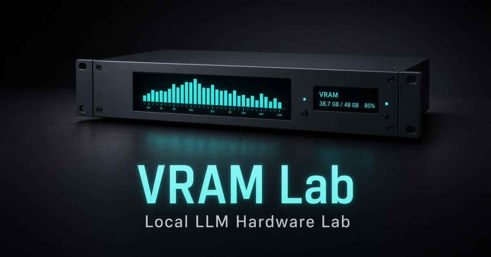

# VRAM Lab

本地 LLM 硬體與模型配置實驗室。選 GPU、模型、量化與 context，即時估算權重 VRAM、KV cache、完整需求、GPU 實際配置、容量缺口、生成速度與 prompt 處理時間。

**線上使用：** [https://kite-yarrow-glow-light.grok.me](https://kite-yarrow-glow-light.grok.me)



資料基準日：2026-11-22。速度與 VRAM 都是**理論估算**，不是實測 benchmark。

---

## 這是什麼

規劃家用／工作站跑本地 LLM 時，先看這組硬體能不能完整 GPU offload、要不要 CPU 承接、context 能開多大、長 prompt 要等多久。設定會存在瀏覽器 `localStorage`，也會同步到網址，複製網址就能分享同一組設定。不需登入。

同一組設定會貫穿：

- 實驗室
- VRAM 推薦
- 對照台
- llama.cpp / Ollama / vLLM 啟動指令

## 功能

- **硬體目錄**：6–8 GB 到 96 GB 獨立顯卡（30／40／50 系、3090×2、A6000、PRO 6000、7900 XTX、9070 XT、Arc B580），以及統一記憶體機器（M4 Pro／M4 Max／M3 Ultra、Ryzen AI Max+ 395、DGX Spark）
- **模型**：Qwen、Llama、Gemma、DeepSeek、Nemotron、Ministral、Phi 等，含 MoE（Scout、V3、Qwen3-A3B）
- **量化**：Q2、Q3_K_M、IQ4_XS、Q4_K_S、Q4_K_M、Q5、Q6、Q8、FP16
- **顯存拆開顯示**：完整需求、GPU 實際配置、CPU／RAM 承接、容量缺口
- **自訂 VRAM**：輸入 4 GB 再載入推薦，容量仍按 4 GB 算；最接近的卡只當速度參考
- **系統 RAM 與後端**：CPU offload 會看 RAM；統一記憶體機器改用整池容量；vLLM 放不下或在 Mac 上就判定不適合
- **MoE expert offload**：MoE 放不下時，llama.cpp 用 `--n-cpu-moe` 只把 expert 放 CPU，速度比逐層切分快
- **Prompt 處理速度**：估算 prefill tok/s 與讀滿 context 要多久，長文件、RAG、agent 用途特別重要
- **分享連結**：網址即設定，例如 `?g=4090&m=gemma3-27b&q=q4km&c=32768`
- **啟動指令**：`llama-server`（含 `--n-cpu-moe`、多卡 `-ts`）、Ollama（伺服器環境變數 + 官方 tag 或 Modelfile）、vLLM（Hugging Face repo、FP8）；後端不支援的組合會標出來
- **VRAM 推薦**：最舒服／最大挑戰／也適合，挑戰檔會列出量化、速度、context、記憶體代價

判定：很適合／可以跑但有妥協／勉強／不適合。

## 估算公式（摘要）

| 項目 | 怎麼算 |
| --- | --- |
| 權重 VRAM | 參數量(B) × 每權重位元 / 8，對齊常見 GGUF 大小 |
| KV cache | `2 × 注意力層 × KV heads × head_dim × context × 每元素位元組 / 1024³`；滑動視窗層（Gemma 3、Llama 4）只算視窗內 token |
| 完整需求 | 權重 + KV + 開銷（CUDA／compute buffer／ggml） |
| 容量缺口 | `max(0, 完整需求 − 可用 VRAM)` |
| 系統 RAM | 約 6 GB 保留 + CPU 承接權重 × 1.15（統一記憶體再加 GPU 配置） |
| 生成速度 | `1 / (GPU 端權重 ÷ GPU 有效頻寬 + CPU 端權重 ÷ CPU 頻寬 + kernel 開銷)`；MoE 只算 active 參數（routed expert 讀取 × 1.8） |
| Prompt 處理 | 有效算力 ÷ (2 × active 參數)；CPU 上的權重每 512 token 經 PCIe 搬一次 |

架構數字來自各模型公開 config。會受後端、CPU、記憶體頻寬、prompt 長度、驅動與是否開 Flash Attention 影響。

## 技術棧

- TanStack Start + React
- Zustand（persist）
- Tailwind CSS v4
- 實驗室本身是純前端，不需登入；設定只存在瀏覽器
- 專案內的 `src/lib/auth`、`src/lib/app-data`、`migrations/` 與 `scripts/` 是 Grok 部署範本附帶的基礎設施，實驗室功能不依賴它們

## 本地開發

```bash
npm install
npm run dev
```

```bash
npm run typecheck
npm run test:lab       # 估算、指令、分享連結的單元測試
npm run test:e2e       # 瀏覽器冒煙測試（自動啟動開發伺服器，或設 BASE_URL）
npm run check:models   # 對照 Hugging Face config.json（Llama／Gemma 需 HF_TOKEN）
```

`npm test` 跑的是 Grok 部署範本附帶的腳本測試，其中部分依賴平台才有的 `.grok/` 檔案，在本機會失敗，與實驗室功能無關。

主要程式在 `src/lib/lab/`（計算、目錄、推薦）與 `src/components/lab/`（實驗室 UI）。

## 授權

私人倉庫。估算僅供規劃參考，請以你本機實際 llama.cpp / Ollama / vLLM 為準。
